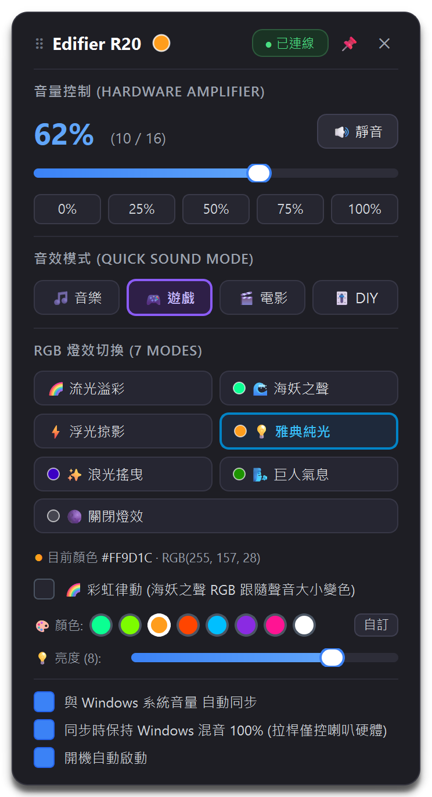
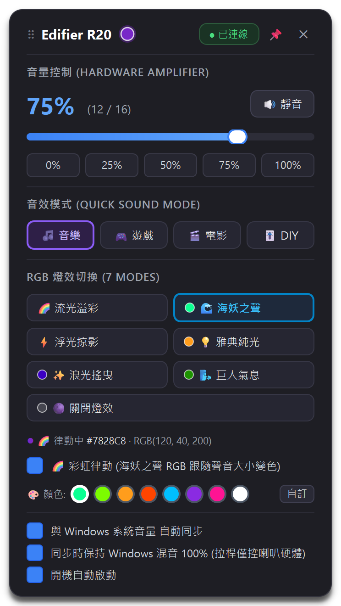

# Edifier R20 喇叭控制面板 (Windows / Linux)

專為 **漫步者 Edifier R20 USB 喇叭** 打造的 Windows / Linux 系統列輕量控制程式。



---

## ✨ 本次更新重點

| # | 需求 | 實作內容 |
|---|------|----------|
| 1 | 面板可移動 + 關閉鈕 | 控制面板可用滑鼠拖曳（標題列或面板空白處），位置會記住；標題列新增 **✕ 關閉鈕** 與 **📌 釘選鈕**（釘選後點面板以外不會自動關閉），`Esc` 也可關閉 |
| 2 | 別台電腦可用的安裝檔 | `EdifierR20Tray-Setup-2.0.0.exe`：免管理員、單一檔案、含開始功能表／桌面捷徑、新增與移除程式項目、解除安裝程式、可選開機自動啟動 |
| 3 | VBScript 可能不受支援 | **已移除 `start_tray.vbs`**：改用原生 `pythonw`／`EdifierR20Tray.exe` 直接背景啟動，不再依賴 `wscript.exe`；舊的 VBS 開機登錄值會自動修正 |
| 4 | 支援 Linux | PipeWire (`wpctl`) / PulseAudio (`pactl`) 系統音量雙向同步、`parec` 聲音律動、freedesktop 開機啟動、hidraw udev 規則、安裝／解除安裝腳本 |
| 5 | 按鈕顯示目前 RGB 顏色 | 標題列即時色點、每個 RGB 燈效按鈕上的顏色圓點、目前色票白框、`目前顏色 #RRGGBB · RGB(r, g, b)` 文字（彩虹律動時即時更新） |

---

## 🌟 核心功能

1. **獨立硬體音量控制 (0 ~ 16 階硬體放大器音量)**
   - 解決 Edifier R20 硬體放大器音量與系統音量不同步的問題。
   - 支援 0% (靜音)、25%、50%、75%、100% 快速預設值切換、靜音與一鍵還原。

2. **RGB 燈效快速切換 (7 種原廠燈效模式)**
   - 🌈 流光溢彩、🌊 海妖之聲、⚡ 浮光掠影、💡 雅典純光、✨ 浪光搖曳、🌬️ 巨人氣息、🌑 關閉燈效。
   - 支援燈效亮度與動畫速度無級調整。
   - **目前顏色顯示**：模式按鈕左側色點、標題列色點、色票白框、hex/RGB 文字。

3. **🌈 彩虹律動 (RGB 顏色跟隨音樂大小變化)**
   - 在「海妖之聲」等可調色燈效（模式 2 / 4 / 5 / 6）下方勾選即可開啟。
   - 即時讀取系統輸出音量峰值（Windows：WASAPI `IAudioMeterInformation`；Linux：`parec` 擷取預設輸出監聽），聲音越大顏色越亮、變色越快。
   - 開啟時標題列色點會發光並即時變色，面板文字會顯示「🌈 律動中」。

4. **系統音量雙向自動同步 (可自由開啟/關閉)**
   - Windows：鍵盤音量鍵 / 工作列音量 → 喇叭硬體同步；可選擇「保持系統混音 100%」。
   - Linux：音量鍵 / 桌面音量 applet → 預設音訊輸出（sink）→ 喇叭硬體同步（`wpctl` 或 `pactl`）。
   - 具備防迴音保護（避免雙向調整互相拉扯）。

5. **可移動的懸浮控制面板**
   - 滑鼠拖曳標題列或面板空白處即可移動，位置自動記憶（多螢幕下會校正回可見區域）。
   - 標題列：拖曳把手、即時顏色色點、連線狀態、📌 釘選、✕ 關閉。
   - 系統匣圖示右鍵 →「📍 面板回到系統匣位置」可重設位置。

6. **動態工作列圖示**
   - 依喇叭連線狀態、音量波紋數、靜音狀態即時更新；右下角色點顯示目前 RGB 顏色（彩虹律動時同步變化）。

7. **極致操作體驗**
   - **滑鼠滾輪**：在面板上滾動微調音量 ±1。
   - **滑鼠左鍵**：點系統匣圖示開／關面板（再次啟動程式本體也會重新開啟面板）。
   - **滑鼠中鍵**：快速靜音／取消靜音。
   - **滑鼠右鍵**：完整快捷選單（燈效、音量、同步、開機啟動、重新連線、結束程式）。
   - **開機自動啟動**：面板勾選即可（Windows 登錄 / Linux `~/.config/autostart`）。

---

## 🪟 Windows 安裝

### 使用安裝檔（推薦，給其他電腦）

1. 將 `EdifierR20Tray-Setup-2.0.0.exe` 複製到目標電腦。
2. 雙擊執行，依畫面指示安裝（約 90 MB，包含 Qt 執行環境，**目標電腦不需要安裝 Python**）。
3. 安裝位置：`%LOCALAPPDATA%\Programs\EdifierR20Tray`（**免管理員權限**、不修改系統檔案）。
4. 安裝程式會建立：
   - 開始功能表「Edifier R20」資料夾（主程式 + 解除安裝）
   - 桌面捷徑（可取消勾選）
   - 「設定 → 應用程式 → 已安裝的應用程式」解除安裝項目
   - 開機自動啟動（可取消勾選）
5. 解除安裝：開始功能表 →「解除安裝 Edifier R20」，或「已安裝的應用程式」；可選擇是否保留個人設定。

> 安裝檔未數位簽章，Windows SmartScreen 可能顯示「已保護您的電腦」，請點「其他資訊 → 仍要執行」。
> 設定與記錄檔位於 `%APPDATA%\EdifierR20Tray`（移除程式不會自動刪除，解除安裝時可選擇清除）。

無聲安裝（適合批次部屬）：

```bat
EdifierR20Tray-Setup-2.0.0.exe --silent --autostart
EdifierR20Tray-Setup-2.0.0.exe --silent --dir "D:\Apps\EdifierR20Tray" --no-desktop --no-autostart --no-launch
EdifierR20Tray-Setup-2.0.0.exe --version
```

### 從原始碼執行（開發者）

```bat
python -m pip install -r requirements.txt
start_tray.bat        :: 背景啟動（無黑視窗）
stop_tray.bat         :: 停止
```

- **不再使用 VBScript**：`start_tray.bat` 會依序嘗試 `pyw` / `pythonw` / `py` 以背景方式啟動 `tray_app.py`；舊版留在登錄檔的 `wscript.exe ... start_tray.vbs` 會在程式啟動時自動改寫成原生指令。
- 桌面捷徑可直接指向 `start_tray.bat`，或使用建置產生的 `EdifierR20Tray.exe`。

### 建置 Windows 安裝檔

```powershell
pwsh -File packaging\build_windows.ps1
```

需求：Python 3.10+（含 PyQt6）。腳本會自動安裝 PyInstaller、產生圖示與版本資源，輸出：

| 檔案 | 說明 |
|------|------|
| `dist\EdifierR20Tray\EdifierR20Tray.exe` | 免安裝資料夾版（含 Qt） |
| `build\uninstaller\Uninstall.exe` | 產生的解除安裝程式（安裝時複製到安裝目錄） |
| `dist\EdifierR20Tray-Setup-2.0.0.exe` | 單一檔案安裝程式（含上述兩者） |

---

## 🐧 Linux 安裝

```bash
git clone https://github.com/Mangotimmy/speaker_control.git
cd speaker_control
bash scripts/install_linux.sh            # 會詢問是否開機自動啟動
bash scripts/install_linux.sh --autostart
bash scripts/install_linux.sh --uninstall [--purge]
```

安裝程式會：

- 建立私有虛擬環境於 `~/.local/share/edifier-r20-tray`（不需系統管理員）
- 建立啟動器 `~/.local/bin/edifier-r20-tray`
- 安裝應用程式選單項目與圖示
- 視需要寫入 `~/.config/autostart/edifier-r20-tray.desktop`
- 以 `sudo` 安裝 hidraw udev 規則（`/etc/udev/rules.d/70-edifier-r20.rules`，讓一般使用者可存取喇叭）

系統需求：

```bash
# Debian / Ubuntu
sudo apt install python3 python3-venv python3-pip \
                 pulseaudio-utils            # pactl + parec
# 或使用 PipeWire（多數新版發行版預設）
sudo apt install wireplumber pipewire-pulse
```

- **系統音量同步**：優先使用 `wpctl`（PipeWire/WirePlumber），其次 `pactl`。
- **彩虹律動**：使用 `parec` 擷取預設輸出（sink）監聽；若不可用會退回以喇叭音量作為律動強度。
- **系統匣圖示**：GNOME 需安裝 AppIndicator 擴充；其他桌面環境（KDE、XFCE、Cinnamon…）通常直接支援。若系統匣不可用，仍可用 `~/.local/bin/edifier-r20-tray` 再次啟動以開啟面板。

Linux 設定檔：`~/.config/edifier-r20-tray/config.json`；記錄：`~/.config/edifier-r20-tray/logs/`。

---

## 🎛️ 使用方式

| 操作 | 功能 |
|------|------|
| 左鍵點系統匣圖示 | 開 / 關控制面板 |
| 拖曳標題列或面板空白處 | 移動面板（位置會記住） |
| `✕` / `Esc` | 關閉面板 |
| `📌` | 釘選：點面板以外時不自動關閉 |
| 右鍵系統匣圖示 | 完整快捷選單 |
| 中鍵系統匣圖示 | 靜音 / 取消靜音 |
| 面板上滾動滾輪 | 音量 +1 / -1 |
| 再次啟動程式（捷徑 / exe） | 重新開啟已關閉的面板 |

### 顏色顯示說明

- **標題列色點**：目前實際的 RGB 顏色；彩虹律動時會出現光暈並即時變化。
- **燈效按鈕色點**：該燈效目前儲存的顏色（模式 1／3 為內建漸層效果，沒有單一顏色；模式 7 為關閉）。
- **色票白框**：目前使用中的預設色；若是自訂顏色，會改為高亮「自訂」按鈕。
- **文字列**：`目前顏色 #FF9D1C · RGB(255, 157, 28)`，彩虹律動時顯示「🌈 律動中」。



---

## ⌨️ 命令列選項

```text
tray_app.py                 正常啟動（單一實例，重複啟動會開啟面板）
tray_app.py --autostart     同上（開機自動啟動使用）
tray_app.py --diagnose      診斷：環境、設定路徑、HID 介面、音訊後端
tray_app.py --diagnose --no-message   診斷但不彈出訊息框（適合腳本）
tray_app.py --version       顯示版本
```

診斷報告會寫入 `<log dir>/diagnose.txt`（Windows：`%APPDATA%\EdifierR20Tray\logs\diagnose.txt`）。

---

## 📂 檔案架構

| 檔案 | 說明 |
|------|------|
| `tray_app.py` | 主程式：系統匣、選單、工作執行緒整合、命令列 |
| `tray_popup.py` | 可移動控制面板、音量 OSD、顏色顯示元件 |
| `r20_controller.py` | Edifier R20 底層 HID 通訊協定（Windows / Linux 介面自動選擇） |
| `audio_meter.py` | 跨平台音訊峰值來源（WASAPI / `parec`） |
| `sound_reactive.py` | 彩虹律動引擎（音量 → RGB） |
| `volume_sync.py` | 系統音量橋接（Windows pycaw / Linux wpctl、pactl） |
| `media_keys.py` | Windows 多媒體鍵攔截（其他平台為 no-op） |
| `icon_generator.py` | 向量系統匣圖示（含即時 RGB 色點） |
| `config.py` | 設定持久化、平台預設值、面板位置記憶 |
| `platform_utils.py` | 跨平台路徑、開機啟動、單一實例、背景啟動、診斷用文字 |
| `run.py` | 背景啟動器（取代 `start_tray.vbs`） |
| `start_tray.bat` / `stop_tray.bat` | Windows 啟動 / 停止（原始碼模式） |
| `start_tray.sh` / `stop_tray.sh` | Linux 啟動 / 停止（原始碼模式） |
| `packaging/` | 圖示產生、PyInstaller spec、安裝程式 / 解除安裝程式原始碼、建置腳本 |
| `scripts/install_linux.sh` | Linux 安裝 / 解除安裝腳本 |
| `tests/` | 單元測試與 offscreen GUI 測試 |

---

## 🧪 測試

```powershell
# Windows（PowerShell）
$env:QT_QPA_PLATFORM = "offscreen"
python -m unittest discover -s tests -t .
```

```bash
# Linux
QT_QPA_PLATFORM=offscreen python3 -m unittest discover -s tests -t .
```

涵蓋：HID 封包組裝與 CRC、控制介面選擇（Windows/Linux 路徑）、設定檔讀寫與遷移、單一實例鎖、面板拖曳與位置記憶、✕／Esc／📌 行為、RGB 顏色顯示（色點、白框、hex 文字）、彩虹律動即時更新。

---

## ℹ️ 設定與記錄檔

| 平台 | 設定檔 | 記錄檔 |
|------|--------|--------|
| Windows（安裝版） | `%APPDATA%\EdifierR20Tray\config.json` | `%APPDATA%\EdifierR20Tray\logs\` |
| Windows（原始碼） | 專案目錄 `config.json` | `%APPDATA%\EdifierR20Tray\logs\` |
| Linux | `~/.config/edifier-r20-tray/config.json` | `~/.config/edifier-r20-tray/logs/` |

可用環境變數覆寫：`EDIFIER_R20_CONFIG`（設定檔路徑）、`EDIFIER_R20_CONFIG_HOME`（資料目錄）。

---

## ❓ 疑難排解

- **系統匣顯示「未連線」**：確認 USB 已連接、喇叭開機；`tray_app.py --diagnose` 會列出 HID 介面。重新插拔或右鍵「重新連線喇叭」。
- **Linux 找不到裝置**：確認 `/dev/hidraw*` 存在且可讀；重新執行安裝腳本以安裝 udev 規則，或 `sudo udevadm control --reload-rules && sudo udevadm trigger` 後重新插拔。
- **Linux 系統音量不同步**：安裝 `wireplumber`（`wpctl`）或 `pulseaudio-utils`（`pactl`）；`--diagnose` 會顯示目前後端。
- **GNOME 沒有系統匣圖示**：安裝 AppIndicator 擴充，或直接再次執行 `edifier-r20-tray` 開啟面板。
- **開機沒有自動啟動**：Windows 檢查 `HKCU\Software\Microsoft\Windows\CurrentVersion\Run\EdifierR20Tray`；Linux 檢查 `~/.config/autostart/edifier-r20-tray.desktop`。
- **安裝檔被 SmartScreen 阻擋**：安裝檔未簽章，選「其他資訊 → 仍要執行」。
